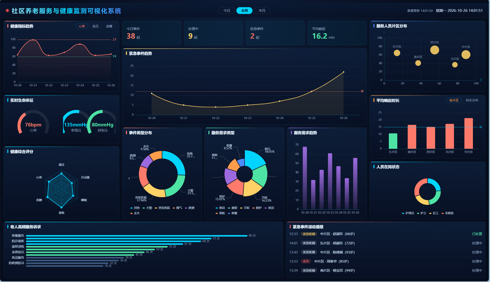

# 社区养老服务与健康监测可视化系统



基于 **Vue3 + ECharts** 的数据大屏，展示老人健康指标、服务需求、紧急事件、服务人员分布与响应时间。

## 技术栈

- Vue3（Composition API）+ Vite
- ECharts 5（折线 / 柱状 / 饼图 / 仪表盘 / 雷达 / 散点 / 词云）
- axios + Mock 数据（`.env` 中 `VITE_USE_MOCK=true` 时走 Mock，改为 `false` 走真实后端 `/api`）

## 快速开始

```bash
npm install
npm run dev      # 开发预览 http://localhost:5173
npm run build    # 打包构建
```

## 大屏模块

| 位置 | 模块 |
| --- | --- |
| 顶部 | 标题栏、告警灯、时间范围切换（今日/本周/本月）、实时时钟 |
| 左列 | 健康指标趋势（心率/血压/血糖）、实时生命体征仪表盘、健康综合评分雷达 |
| 中列 | 今日服务概览统计卡、紧急事件趋势、事件类型分布、服务需求类型、需求趋势 |
| 右列 | 服务人员片区分布、平均响应时长（目标 15 分钟）、人员在岗状态 |
| 底部 | 老人高频服务诉求词云、紧急事件滚动播报 |

## 目录结构

```
src/
├─ api/          # request.js 统一封装 + 各数据域 API 模块
├─ mock/         # Mock 数据生成器（随机漂移，30s 轮询可见变化）
├─ components/   # 大屏组件（标题栏/面板容器/各图表组件）
├─ hooks/        # useEcharts / usePolling / useScreenAdapter
├─ views/        # Dashboard 大屏主页面
└─ styles/       # 深色科技风全局样式
```

> 数据口径：响应时长 = 事件受理 → 人员到达；平均响应目标线 15 分钟。
# community-elderly-care-dashboard
基于Vue3 + Vite + ECharts开发的社区养老服务与健康监测可视化大屏，支持老人健康指标、服务需求、紧急告警事件、服务人员分布、响应时长数据可视化，内置Mock模拟数据，一键切换真实后端接口，适合毕业设计/课程实训。
